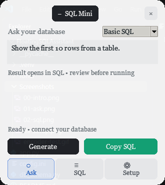
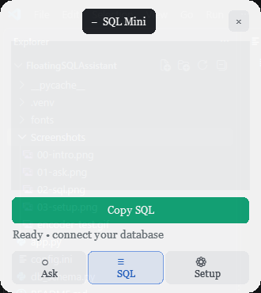
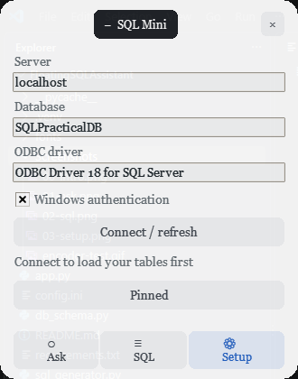

<div align="center">
  
  <h1>Floating SQL Assistant</h1>
  <p><strong>Turn natural-language questions into reviewable SQL Server queries—without leaving your workflow.</strong></p>
  <p>
    
    
    
    
  </p>
</div>

---

## ✨ A tiny SQL copilot that stays close at hand

Floating SQL Assistant is a compact, always-on-top Windows app for working with SQL Server and SSMS. It reads your database's **schema metadata**, helps an AI provider draft T-SQL from a plain-English request, and lets you review and copy the result into SSMS yourself.

> **You stay in control:** the app does not execute generated SQL or type into another window. Review the query, then paste it into the intended SSMS query window.

## 🎬 See it in action

The walkthrough below shows the floating interface and its animated intro. It stops before connecting to SQL Server or contacting an AI provider.

<div align="center">
  
</div>

## 🖼️ Screenshots

<table>
  <tr>
    <td align="center"><strong>01 · Ask</strong></td>
    <td align="center"><strong>02 · SQL</strong></td>
  </tr>
  <tr>
    <td align="center"></td>
    <td align="center"></td>
  </tr>
  <tr>
    <td align="center">Describe what you need and choose Basic SQL, CTE, Joins, or Aggregation.</td>
    <td align="center">Review the generated query before copying it to SSMS.</td>
  </tr>
  <tr>
    <td align="center"><strong>03 · Setup</strong></td>
    <td align="center"><strong>04 · Intro</strong></td>
  </tr>
  <tr>
    <td align="center"></td>
    <td align="center"></td>
  </tr>
  <tr>
    <td align="center">Set the SQL Server connection and load its schema.</td>
    <td align="center">A colorful animated welcome in the compact floating window.</td>
  </tr>
</table>

## 🚀 What it does

- **Floats above your other windows** in a compact, draggable dock.
- **Reads SQL Server schema metadata** to give the generator table, column, and relationship context.
- **Turns a plain-English prompt into T-SQL** with selectable query styles.
- **Supports local and cloud AI**: tries Ollama first, then configured Gemini, then the OpenAI-compatible cloud endpoint.
- **Reveals generated SQL with a typing animation** and provides an explicit copy action.
- **Keeps execution manual**: inspect and edit the output, then paste it into SSMS when you are ready.

## 🧭 How it works

1. In **Setup**, enter your server, database, and installed ODBC driver; connect to load schema metadata.
2. In **Ask**, describe the query you want and select a style.
3. Generate the SQL and review or edit the result.
4. Choose **Copy SQL**, switch to SSMS, and paste into the query window you intend to use.

## 🛠️ Get started

### Requirements

- Windows 10 or 11
- Python 3.10 or later
- SQL Server and SQL Server Management Studio (SSMS)
- Microsoft ODBC Driver 18 for SQL Server (or another installed SQL Server ODBC driver)
- Optional: [Ollama](https://ollama.com/) for local generation

### Install

Open PowerShell in the project folder:

```powershell
py -m venv .venv
.\.venv\Scripts\Activate.ps1
python -m pip install --upgrade pip
pip install -r requirements.txt
```

If PowerShell prevents environment activation, install with the environment's Python directly:

```powershell
.\.venv\Scripts\python.exe -m pip install -r requirements.txt
```

### Configure the database

Edit `config.ini` and set the values in `[database]`:

```ini
[database]
server = localhost
database = YourDatabase
driver = ODBC Driver 18 for SQL Server
trusted_connection = true
```

Use the exact ODBC driver name installed on your PC. For a named SQL Server instance, set `server` to that instance (for example, `.\SQLEXPRESS`). Windows Authentication is recommended; the SQL login fields are only needed when `trusted_connection = false`.

### Configure an AI provider

**Local Ollama:** install Ollama, download a model, and start the service:

```powershell
ollama pull qwen2.5:3b
ollama serve
```

Set the model in the `[ollama]` section of `config.ini` if you want to use a different one. Ollama is attempted first.

**Optional cloud fallback:** configure `[gemini]` with an API key to enable Gemini fallback. If Gemini is not configured or fails, the app can use the OpenAI-compatible endpoint in `[cloud]`. Alternatively, provide a Gemini key using the `GEMINI_API_KEY` environment variable. Cloud generation sends both your request and schema metadata to the provider, so only use it if your organization's policy permits sharing that information.

For example, fill in the provider settings in `config.ini` with your own model names and keys:

```ini
[gemini]
base_url = https://generativelanguage.googleapis.com/v1beta
model = gemini-2.5-flash
api_key = YOUR_GEMINI_API_KEY

[cloud]
base_url = https://api.openai.com/v1
model = YOUR_MODEL
api_key = YOUR_CLOUD_API_KEY
```

The cloud `base_url` should be the endpoint's API root; the app adds `/chat/completions`. Leave a provider key blank if you do not plan to use that provider.

Keep `config.ini` private, especially if it contains API keys or database credentials.

### Run

```powershell
python app.py
```

Connect to the database in **Setup**, then describe your query in **Ask**.

## ⌨️ Handy controls

| Action | Control |
|---|---|
| Expand or collapse the dock | Click **SQL Mini** |
| Move the window | Drag its header |
| Skip the startup intro | Click the intro or press `Esc` |
| Generate a query | Click **Generate** or press `Ctrl+Enter` |
| Move between pages | Click a page or use `Alt+↑` / `Alt+↓` |
| Copy the full generated query | Click **Copy SQL** |

## 🔒 Safety by design

- Schema loading reads SQL Server catalog metadata; it does not read table rows.
- Generated SQL is **not executed** by the app.
- The app does not inject keystrokes or automatically paste into SSMS.
- Review generated SQL before running it, and use a least-privilege database login.

## 🧰 Troubleshooting

| Issue | Check |
|---|---|
| Cannot connect | Confirm SQL Server is running, the server/instance and database are correct, and the ODBC driver name matches an installed driver. |
| Login fails | Check the selected authentication mode and your SQL Server permissions. Prefer Windows Authentication where possible. |
| Generation fails | Ensure Ollama is running and the configured model is downloaded, or configure a cloud fallback. |
| Certificate or SSL error | Local development uses `TrustServerCertificate=yes`; follow your organization's security requirements for production. |

## 📌 Current scope

This is an MVP for generating, reviewing, editing, and copying SQL. Reconnect after database schema changes to refresh the schema context. It does not execute queries, validate query results, or automate SSMS.

---

<div align="center">
  <sub>Made for a smoother loop: ask → review → copy → run when you're ready.</sub>
</div>
